<div align="center">

**A skincare brand storefront built in Next.js — then handed over to the client.**

`Next.js 16` · `TypeScript` · `Tailwind` · `GSAP` · `Lenis`

</div>

---

## The build

Skin Evidance is an evidence-led skincare brand. The brief was a storefront that
felt like the product: clinical, unhurried, and expensive — without the months
of agency time that usually buys that.

It ships as **30 statically rendered pages**: a scroll-scrubbed hero, three
product ranges with segment browsing, clinical results, a waitlist, an enquiry
flow and a working cart.

I built it end to end and handed it over. The client runs it from here.

## Demo

> Not publicly deployed — the client owns the domain and the launch date, so
> this is a capture of the real build running locally.


<sub>The GIF is compressed for GitHub. For the crisp version see
[`docs/media/demo.mp4`](./docs/media/demo.mp4).</sub>

## What is interesting in here

| | |
| --- | --- |
| **Scroll-scrubbed hero** | The product shot is a frame sequence driven by scroll position rather than a video element, so it scrubs both ways, holds any frame sharply and never fights the browser's autoplay rules. Frames live in `public/hero/`, preloaded and decoded ahead of the scroll. |
| **Three ranges, one data source** | Products, ranges and segments come from a single typed source, so the range pages, the browse-by-segment grid and the cart never disagree about what exists. |
| **Smooth scroll that behaves** | Lenis drives the page, and every programmatic jump goes through it — a plain `scrollIntoView` gets animated straight back, which is a cheap bug to ship by accident. |
| **Static output** | No server at runtime. The whole storefront exports as static pages, so the client can host it anywhere for nothing. |

## Running it

```bash
npm install
npm run dev     # http://localhost:3000
npm run build
```

## Layout

```
src/            app routes, components and the product data source
public/hero/    the hero frame sequence (desktop + mobile)
public/products/ product photography
docs/           reference notes and the media in this README
tools/          build scripts, including the README banner generator
```

The banner above is generated, not hand-drawn:

```bash
python -I tools/build-readme-banner.py
```

---

<sub>Built by <a href="https://github.com/dipak90000">Dipak Bariya</a> — vibe coder &amp; AI tool expert.
<a href="https://www.linkedin.com/in/dipak-bariya-39abbb300/">LinkedIn</a> ·
<a href="mailto:bariyadipak34@gmail.com">bariyadipak34@gmail.com</a></sub>
